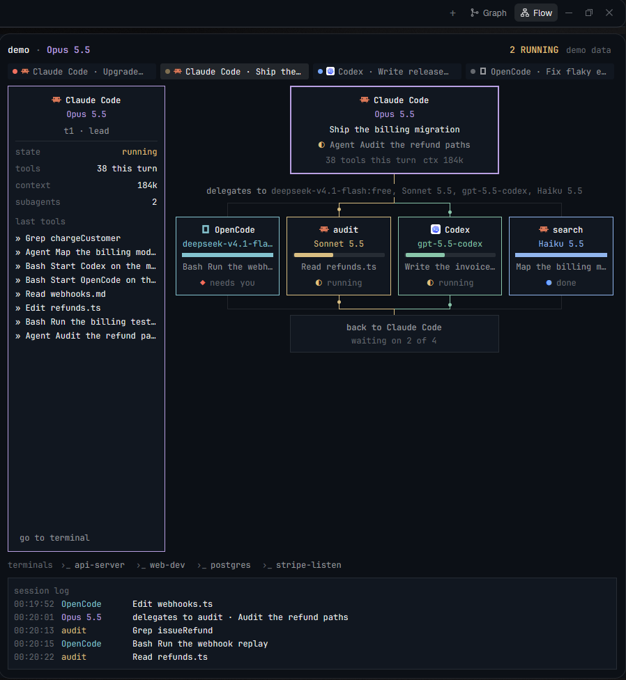
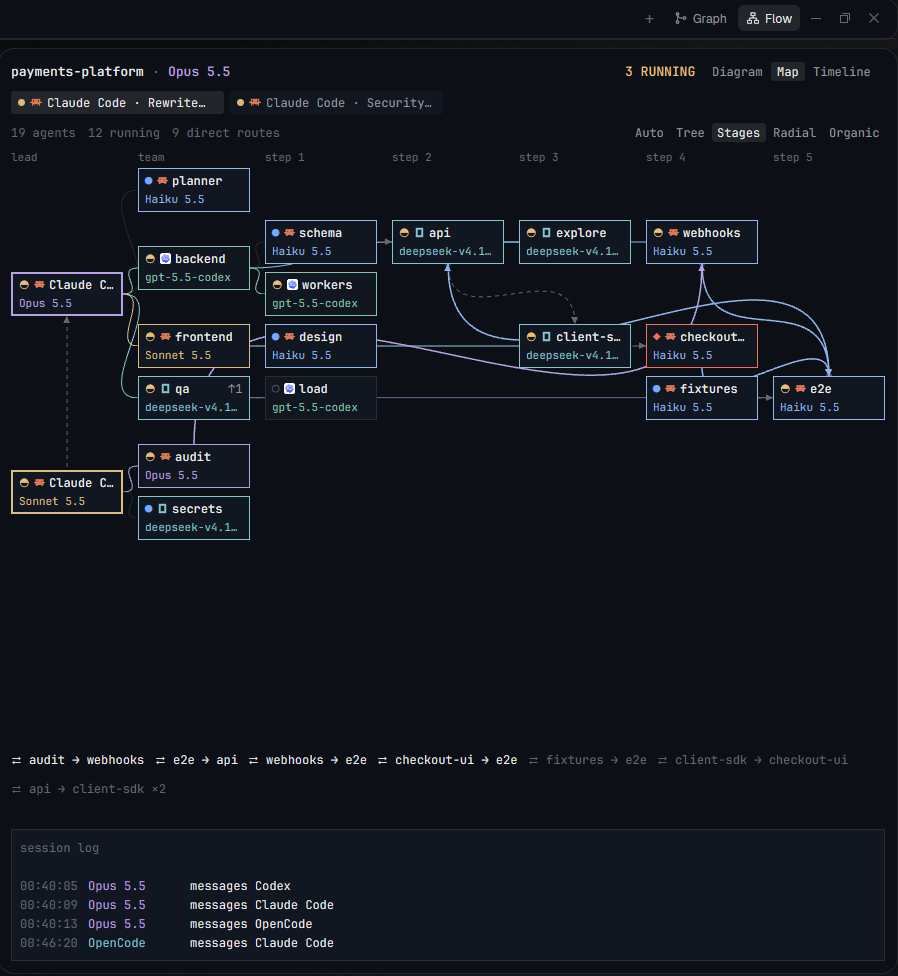
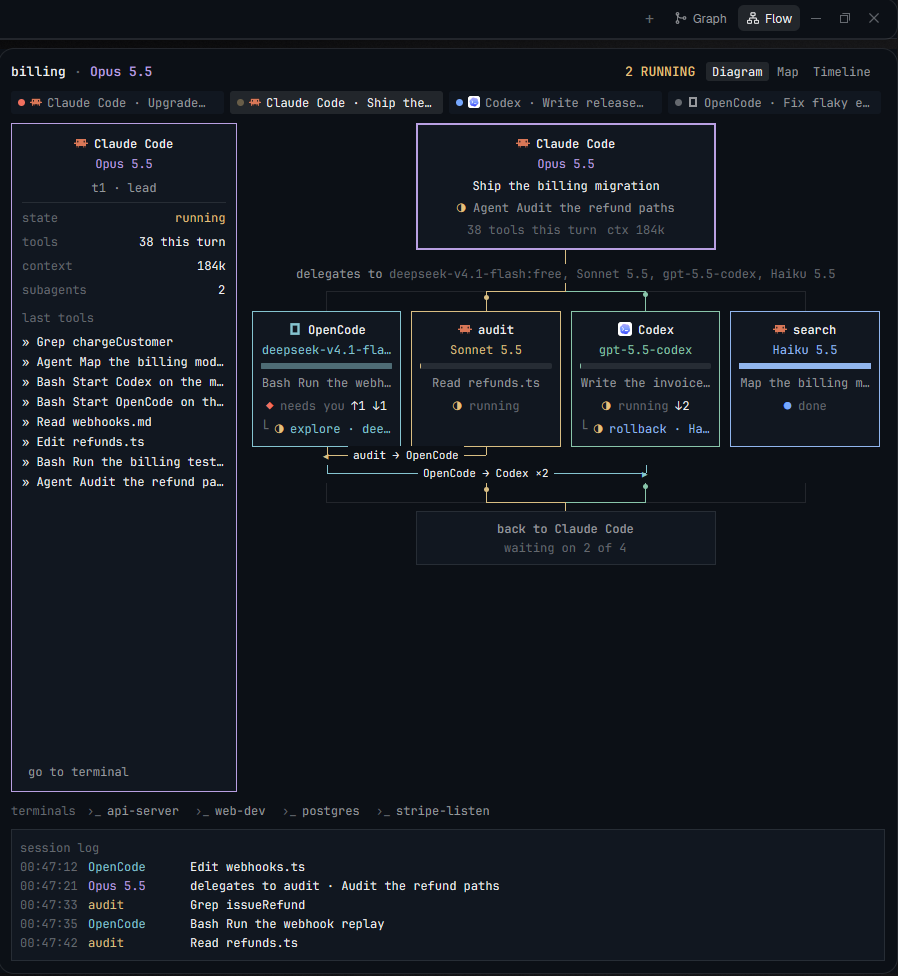
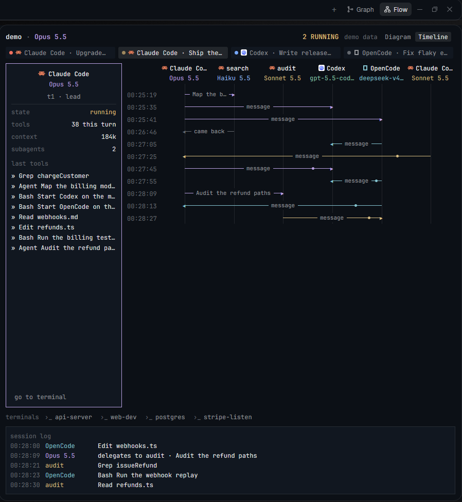

# Agent Flow, a Herdr mod

A live diagram for the [Herdr](https://herdr.dev) desktop app that shows how the agents in the
current space work together: the orchestrator, each agent or subagent it delegated to with its
model, the messages they send each other, and what came back. It changes with the space you call
it from, and scales from one agent to a whole team.

| Diagram | Timeline |
| --- | --- |
|  |  |

Install: copy `mods/agent-flow/` into `~/.config/herdr-app/mods/`, merge `keys.json` into yours,
press `ctrl-shift-g`. Needs Node on PATH, and Node 22 or later for opencode and Codex models.
[RECIPE.md](RECIPE.md) is the brief to build it from scratch.

The pictures show it as a side panel, opened from a Flow button beside Graph, on example data
that ships with the mod: `herdr-app do tab.new --mod agent-flow --props '{"example":"platform","view":"map"}'`
(or `"team"`). With no such props it shows your live agents. The key opens it as an overlay out of
the box; the button lives in your own layout and tab bar, and RECIPE.md says how to add it.

## What it shows

- **Agent and model on every box.** Claude Code, opencode, Codex and Oh My Pi show their model;
  other agents show their name and status.
- **Subagents.** Agents started with `hc run`, and the subagents Claude Code and opencode run
  inside their own process, which have no terminal of their own.
- **Who's working.** The whole line from the orchestrator to a working agent lights up in its
  color. Bars say running or finished: no agent reports real progress, so there are no percentages.
- **Agents talking to each other.** A message between two siblings gets its own line under the
  boxes, with an arrow and a count, and `↑2 ↓1` on a box counts its messages with the lead. Only
  who talked to whom shows, never what was said.
- **Second tier.** What each agent delegated in turn, as rows inside its box.
- **Timeline.** A sequence diagram of the whole space, one column per agent, so flows that never
  touch the orchestrator show too, like two orchestrators writing to each other.
- **Map.** Any number of agents at any depth, arranged by how they work. `Tree` by tier, `Stages`
  by team and by the order work moves through it, `Radial` in rings around the orchestrator,
  `Organic` with agents that talk pulled together. The arrangement changes, the hierarchy doesn't:
  orchestrators stay first and a parent always comes before its children. `Auto` picks one from
  who's talking to whom and rearranges as that changes.
- **Plain terminals apart.** A dev server the lead started sits in a list under the diagram,
  never as an agent.
- **A session log** of tool calls, delegations and status changes.

## What it reads

The mod runs `node mods/agent-flow/scan.cjs` every 3 seconds while it's on screen, and only
reads local files: Claude Code's session transcripts in `~/.claude`, opencode's database in
`~/.local/share/opencode`, Codex's state in `~/.codex` and Oh My Pi's session files in
`~/.omp/agent/sessions`, the last three read-only. It reaches no network. On screen you get
tool names and short hints such as a file name or the start of a command, never prompts or
tool output. Messages are seen through `hc send`, Claude Code's
`SendMessage` and the tags `hc` adds on arrival; for those it keeps the target and the sender, not
the text.

These are private formats, so an agent's update can leave a box at `model unknown`.

## License

[MIT](LICENSE).
