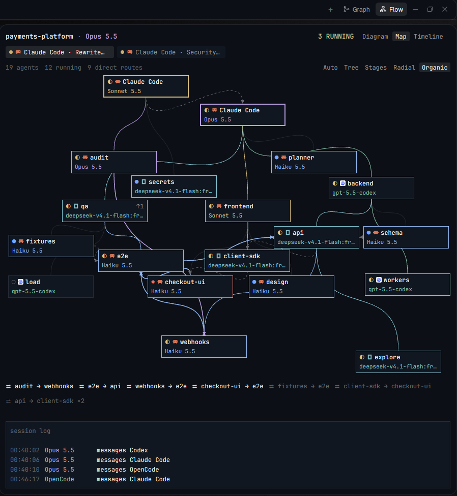
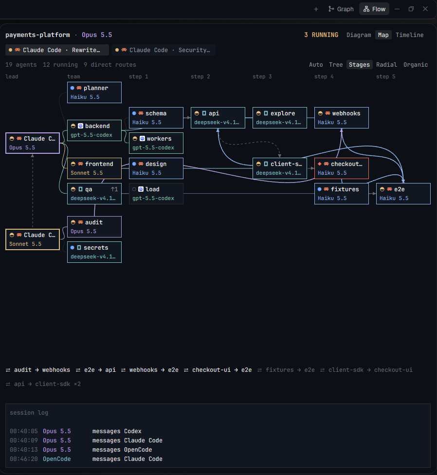
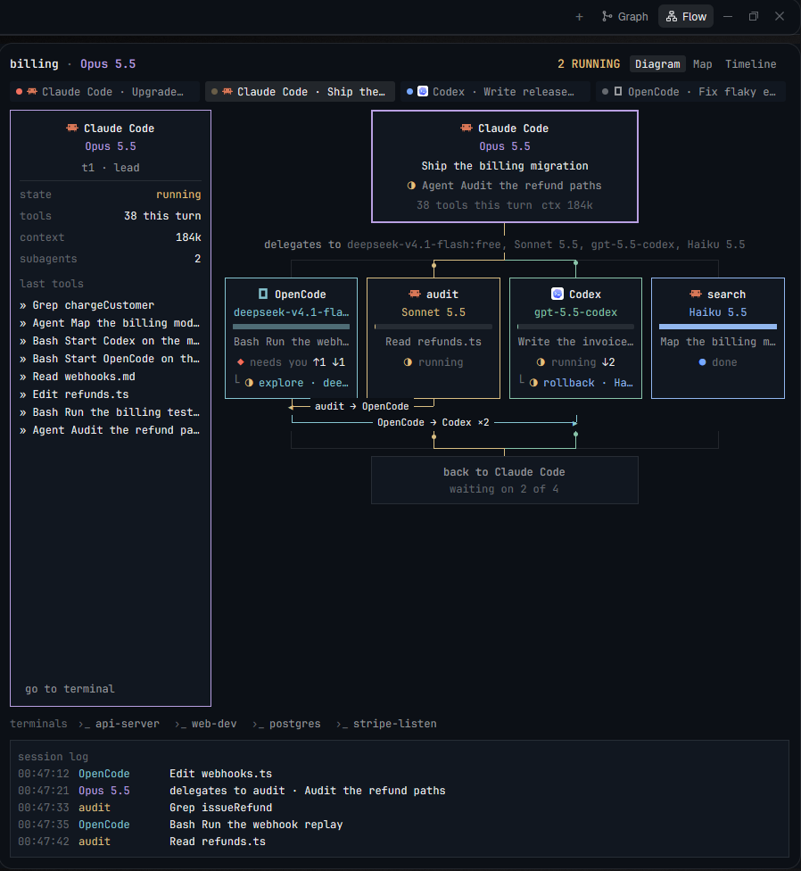
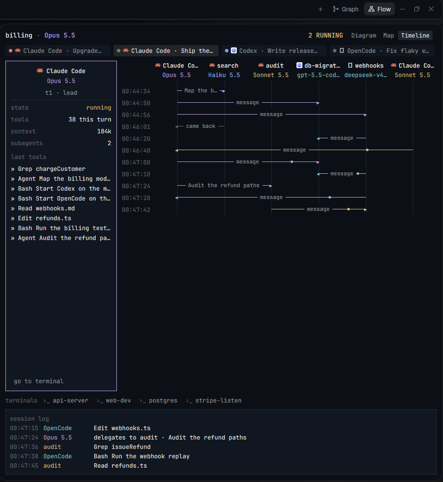

# Agent Flow

A live diagram of how the agents in the current space work together: the orchestrator on top, each agent or subagent it delegated to in its own box with its agent name and model, the line to whoever is working lit in that agent's color, and the messages agents send each other. A Map view places any number of agents by how they work together, always keeping the hierarchy, and a Timeline view shows the space as a sequence diagram. It follows the space you call it from. Plain terminals stay out of it.

## What you see

Everything is `JetBrains Mono`, 12px (header 13px semibold), on `theme().canvas` in an overlay and `theme().chrome` anywhere else, with 12px padding and square-cornered 1px boxes on `theme().background`.

Top to bottom:

1. **Header.** Left: the space's name, `·`, the lead's model. Right: `N RUNNING` in `working` color (`muted` at 0), a `Diagram` / `Map` / `Timeline` switch (the shown one on `selected`) and, in an overlay, a `✕`. Below 340px wide the model drops out.
2. **Lead chips.** One chip per lead in this space, most urgent first: a 7px status dot, the program icon, `Agent · title` cut at 170px. The chosen one has `selected` as its background.
3. **Body.** From 640px wide, a 226px detail panel on the left. To its right the flow, in one of two shapes:
   - **Diagram** (at least 500px of room). A 300px lead box with agent name and icon, model, title, status mark with the current tool, and `N tools this turn  ctx 122k`. Then a stem, `delegates to <models>`, a stem, a 20px fan, up to 4 child boxes (at most 250px; one per 150px of room). Under 170px a box drops the tool count and a subagent shows only its type (`audit`), with the agent's icon, one 18px lane per message route between two boxes (at most 3), a fan back, and a 300px `back to <agent>` box saying `waiting on 1 of 3` or `3 of 3 back`. More children than fit show as `+N more`. A lane is a line from one box's center to the other's, `▶` or `◀` at the receiver, and `OpenCode → Codex ×2` on it. A box also shows `↑2 ↓1` (messages to and from the lead) and up to 3 rows of what it delegated in turn: `└ ◐ rollback · Haiku 5.5`.
   - **List** (narrower, such as a 368px side panel, or after clicking `+N more`). The lead and `back to` boxes run full width and the children are stacked rows. A 1px rail runs down the left edge from the lead, with a 13px tick into each row. Sibling messages are lines of `⇄ OpenCode → Codex ×2` under the rows.
   - **Map.** Takes the whole width (no detail panel). A line of `19 agents  12 running  9 direct routes` and an arrangement switch: `Auto`, `Tree`, `Stages`, `Radial`, `Organic`. Below, a 44px node per agent or subagent (168px wide, 136 under 700px of room, 112 under 480): status mark, icon, its terminal name or type, `↑2` for messages to its parent, and the model. An orchestrator has a 2px border. Parent and child join with a 1px curve, in the child's color while it works. Messages that aren't parent and child are 1.5px curves with an arrowhead and a pulsing dot in the sender's color; after 90 seconds, 1px dashed in `dim`. Under the map, up to 7 routes as `⇄ schema → api ×2`.
   - **Timeline.** A column per agent and subagent in the space (92px or more, the lead first, then those with traffic): name and model on top, a 1px lifeline down. Below, a 24px row per event, oldest on top: the time in a 64px gutter (from 560px of room), an arrow between two lifelines in the sender's color (`dim` for `came back`) and its label: `message`, the delegated task, or `came back`.
4. **Terminals strip.** Only when the lead started plain terminals: `terminals  ›_ api-server  ›_ web-dev`, dim, no boxes.
5. **Session log.** A 132px box (96px when the view is under 620px tall) titled `session log`: the last 6 rows (3 when short) of time, who, what. The time drops out under 500px wide.

Every agent shows two lines: the agent (`Claude Code`, `OpenCode`, `Codex`) and the model under it (`Opus 5.5`, `deepseek-v4.1-flash:free`), or dim `model unknown`. A subagent inside a process reads `Claude Code · audit`.

Colors by model, from the theme: Opus `ansi5`, Sonnet `ansi3`, Haiku `ansi4`, Fable `ansi2`; without one of those, opencode `ansi6`, Codex `ansi2`, anything else `accent`.

## How it behaves

- **The space.** It shows the active space (`focused().space`): its leads, chips and log. Changing space starts over, clearing the chosen lead and box. A space with no agents says `No agents in <space>`. `props().space` pins a copy to one space.
- **The lead** is an agent in this space with no parent in this space. It follows the focused terminal (a focused child selects its parent) until a chip is clicked.
- **working**: spinner frames `◐ ◓ ◑ ◒` at 160ms, a 56px block sliding across the 6px bar, and the whole path from the lead lit in the box's color, with a dot running on its stem. The trunk, the bar and the stem all change, not only the last piece. Where paths share a piece, the first live box's color wins.
- **blocked** (and `error`): `◆`, full bar pulsing in opacity, `needs you`.
- **done**: `●`, full bar, grey line.
- **idle**: `○`, empty bar.
- **stale**: a subagent not marked finished and silent for 3 minutes: `no activity`, border in `border` color.
- **There are no percentages.** Nothing reports how far along an agent is, so the bar only says running or finished. Tool counts are real, with `≥` when the transcript's tail didn't reach the start.
- **Messages.** A route stays drawn for 10 minutes. For its first 90 seconds it's in the sender's color with a dot running along it; after that it's `dim`. Only who talked to whom shows, never what was said.
- **The arrangement changes, the hierarchy doesn't.** `Tree`: a column per tier, a row per leaf. `Stages`: a lane per team, the orchestrator left, then the team's lead, then its members in columns `step 1`, `step 2`... by how many hands the work passed through; a child is always right of its parent. `Radial`: the chosen lead in the middle, each tier a ring. `Organic`: agents that talk are pulled together, freely inside a band per tier, so orchestrators stay on top and each tier stays under the last. `Auto` shows its pick (`Auto: Stages`): stages when work moves along a line (3 or more routes between workers with few loops), organic when it goes around, radial past 9 agents, otherwise a tree. So it rearranges as agents start talking, and nodes slide over 450ms. An orchestrator is never a step.
- The chosen view and arrangement are remembered between starts, per copy.
- A node that is an orchestrator picks it as lead on click; any other terminal node peeks.
- **Timeline** covers every agent in the space, so flows that never touch the chosen lead show too, including two leads talking to each other.
- **Clicks.** A child box opens it in the detail panel, or inline in list mode; again closes it. The lead box goes back to the lead. A chip picks a lead. `go to terminal` runs `agent.focus` and closes the overlay. `peek terminal`, terminal-strip entries and a second-tier row that is a terminal run `terminal.peek`. `+N more` shows every box as the list, and `back to the diagram` returns.
- Closed in a hidden panel it doesn't scan. It scans every 3 seconds only while it's on screen.

## Built from

One mod, `mods/agent-flow/`:

- `main.js`: the view.
- `scan.cjs`: a Node script run by `exec("node", ["--no-warnings", <path>, "opencode=<folder>", "codex=<folder>", ...])`, one argument per terminal running that agent. It prints JSON and reads:
  - Claude Code: `~/.claude/sessions/<pid>.json` for live sessions (`CLAUDE_CONFIG_DIR` moves it), the tail of `~/.claude/projects/<folder-slug>/<session>.jsonl`, and `<session>/subagents/agent-*.jsonl` with `.meta.json` (`agentType`, `description`, `finished`).
  - opencode: `~/.local/share/opencode/opencode.db` read-only, tables `session_v2` and `session_message`.
  - Codex: `~/.codex/state_*.sqlite` read-only, table `threads`; with no thread, the `model =` line of `config.toml`.
  - Messages, from the same files: a shell tool call matching `hc send <target>`, or Claude Code's `SendMessage`, gives `sends: [{t, to}]`; a `<hc from="t7 ...">` tag on an incoming message gives `recvs: [{t, from}]`, used only for senders with no transcript, such as Codex. A `to` is an address, a terminal name, a subagent id or a type, so it resolves against the agents in `main.js`; what doesn't resolve stays in the log.
- `shapes.js`: where each node sits on the Map. Pure geometry from `{key, parent}` nodes and `{from, to}` routes: `tree`, `stages`, `radial`, `organic`, and `choose` for Auto.
- `examples/team.js` and `examples/platform.js`: example data, with props `{ "example": "team" }` (an orchestrator with mixed agents in every state, messages between siblings, a second tier, a second lead writing to the first) or `{ "example": "platform" }` (19 agents in three teams, three tiers deep, whose work moves along a pipeline without touching the orchestrator). Their clock is frozen, so routes stay drawn. `"view"` and `"shape"` props open a given view and arrangement. Nothing in them runs unless those props are given.
- `flow.svg`: a tinted icon for anyone adding a tab bar button.
- `mod.json`: `{ "place": "none", "title": "Agent Flow", "overlay": { "kind": "dialog", "width": 0.9, "height": 0.92 } }`.

`keys.json` binds `ctrl-shift-g` to `mod.open:agent-flow`.

Herdr functions: `agents`, `terminals`, `panes`, `spaces`, `focused`, `theme`, `props`, `run`, `exec`, `appHome`, `closeOverlay`, `layout`. Commands: `agent.focus`, `terminal.peek`. A terminal is an agent when it has a `report` or `program.agent`; children are terminals whose `parent` is the lead.

It works three ways: as an overlay (the key), as a pane (`pane.split {direction, mod: "agent-flow"}`), or as a block in a layout. For a side panel beside Files and Changes, add `{ "id": "flow", "type": "block", "content": { "mod": "agent-flow" } }` to the `panel-body` stack in a layout of your own, and a button in a cloned `tabs` mod, as in the preview, that runs `layout.select {stack: "panel-body", child: "flow"}` and `layout.show {id: "panel"}`.

The mod runs a program and reads files outside its folder, always locally and never over the network. `scan.cjs` prints tool names, short hints (a file's name, a Bash description, a search pattern, the start of a command that has no description) and subagent descriptions. For a message it prints the target only. It never prints prompts or tool output. Those hints do show up on screen.

## Watch out

- **Needs Node on PATH**, and Node 22 or newer for the opencode and Codex models. Without Node the header says `no scan: ...`; without `node:sqlite` those agents show `model unknown`.
- **Private formats.** Transcripts, `.meta.json`, `opencode.db` and Codex's state file aren't public APIs. An update can break a reader; it should then fall back to `model unknown`, not crash.
- **`fs/promises` has no stat and no partial read**, which is why `scan.cjs` exists. Read tails: 6 MB for a session because one screenshot is about 1 MB of a row, 2 MB for a subagent so counts stay exact.
- **Print stable JSON.** Keep "now" out of the output and compare it to the last one, or every scan redraws the window.
- **Sessions don't name their terminal.** They pair up by agent and folder. Two of one agent in one folder may swap models; the busiest terminal takes the most recently active session.
- **Keep hidden copies quiet.** A layout block stays alive while hidden, so walk `layout()` (hidden nodes, a stack's `active`). A pane or overlay copy isn't in the layout, so check `panes()` and `props().overlay` too, or a closed panel stops those scanning.
- **Agents outside `agents()`.** A child without a pane isn't listed there: read `terminals()`. It may have no space label, so take its parent's.
- **Status comes from Herdr.** A terminal whose program stopped reporting isn't an agent here either, even if the agent still runs.
- Other agents (Gemini, Cursor, ...) show name and status, with no model or tools.
- Codex shows no tools. opencode subagents and Codex threads were written from the schema and weren't exercised on real data.
- Animate with `.frames` and `.loop`, not timers. `.loop` runs there and back.
- Every clickable box needs its own `.id()` before `.on_click`.
- **Elements are single use.** Building lifelines once and adding them to every row fails with `element div was already added to a parent`. `herdr-app check` doesn't see it when the failing view isn't the first one rendered: open every view in the app.
- **Hierarchy first.** Forces and step ranks alone scatter tiers and can put a child before its parent. Give every shape the rule: bands per tier in `Organic`, `max(step, parent + 1)` in `Stages`. Keep drawing parent lines in every shape.
- **Herdr interrupts a render that runs long** (`interrupted`, in the stack). `Organic` runs in render, so it does 90 passes, and its result is cached by a signature of nodes, routes and size. It's recomputed only when those change.
- Curves use `window.paint_path` with `PathBuilder`: one stroked path per color, not one element per line. `.loop` can't follow a curve, so a live route pulses at its head.
- Lanes and the Timeline place things with absolute `left` from the room computed from `on_size_change`, because a mod can't measure its children.
- `.loop` runs there and back, so a dot goes both ways; the arrow says the direction.
- Messages sent any other way (a file, a socket, a script calling `hc`) aren't seen.

## Done when

- `herdr-app check mods/agent-flow` passes and `herdr-app status` shows no errors.
- `ctrl-shift-g` opens the overlay, and again closes it.
- `herdr-app do tab.new --mod agent-flow --props '{"example":"team"}'` shows four chips, and under `Claude Code` (Opus 5.5) `Ship the billing migration` the boxes `OpenCode` (`needs you`, `↑1 ↓1`, `explore` under it), `audit` (Sonnet 5.5, running), `Codex` (`gpt-5.5-codex`, running, `↓2`, `rollback` under it) and `search` (Haiku 5.5, done), lanes `audit → OpenCode` and `OpenCode → Codex ×2`, then `waiting on 2 of 4` and four entries in the terminals strip.
- Its Timeline has a column for each agent and a message from the `Sonnet 5.5` Claude Code, a second lead, to the Opus one.
- `--props '{"example":"platform","view":"map"}'` shows `19 agents`, `Auto: Stages`, lanes for backend, frontend and qa, and columns up to `step 5`. Switching to `Organic` keeps both orchestrators on top and every worker below its team.
- `Tree`, `Stages`, `Radial` and `Organic` all show a line from each parent to each child.
- With 4 or more workers exchanging `hc send`, `Auto` changes arrangement by itself.
- With two agents exchanging `hc send`, a lane or `↑↓` count appears within one scan and the Timeline gets a row each way.
- With an agent working, the line from the lead to its box is its color from end to end, and a finished sibling's stays grey.
- Selecting another space changes the title, chips and boxes; a space with no agents says `No agents in <space>`.
- A plain terminal started with `hc run` by an agent appears in the terminals strip and never as a box.
- A real Claude Code subagent shows the model from its transcript, `running`, then `done`.
- Narrowed under 500px, the diagram becomes the list with the rail, and under 640px the detail panel goes.
